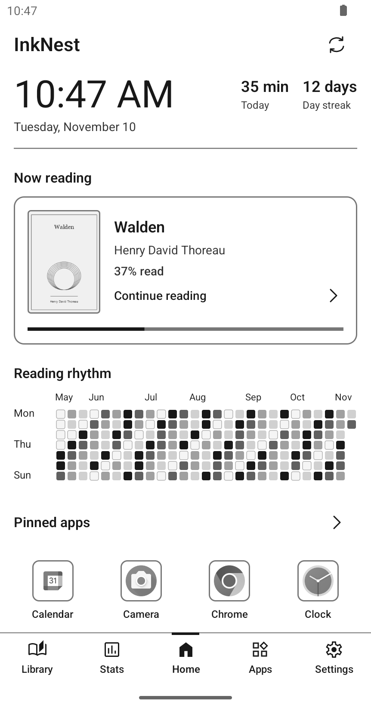
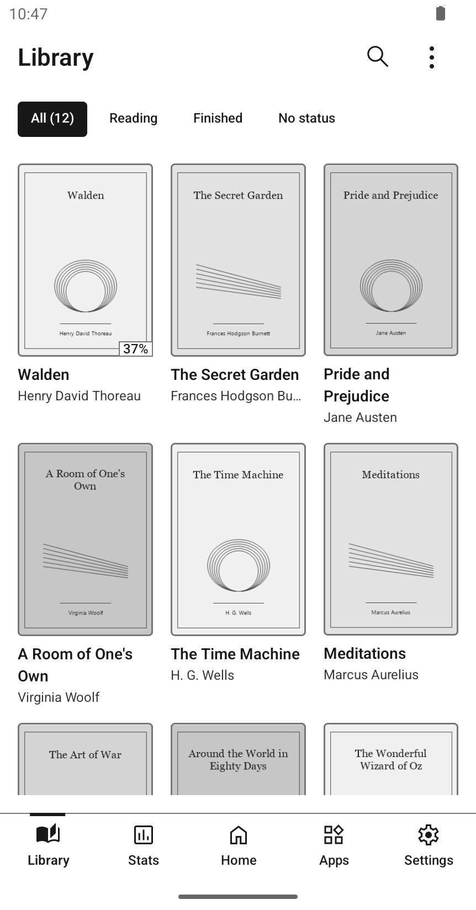
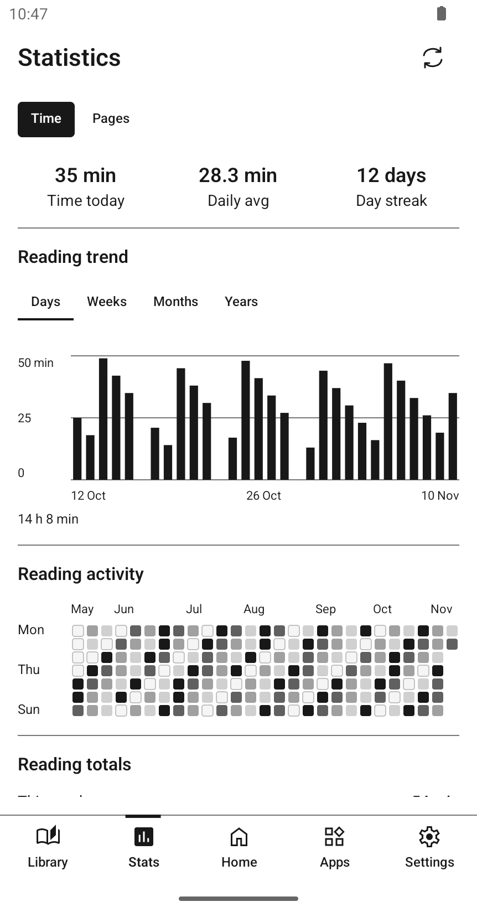
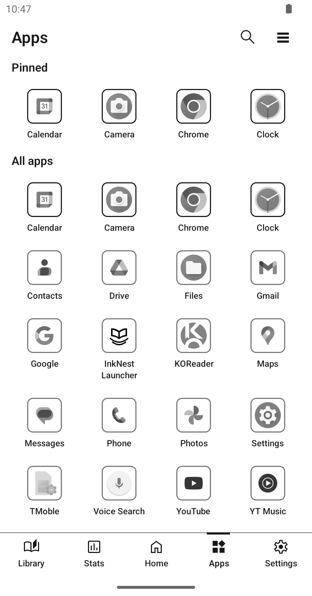
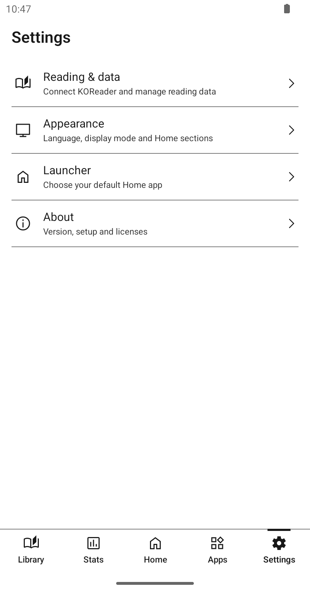

# 📖 InkNest


[](https://github.com/2techy/inknest/releases/latest)
[](https://github.com/2techy/inknest/actions/workflows/ci.yml)
[](docs/en/setup.md)
[](LICENSE)

InkNest is an offline Android launcher built around reading on E-Ink devices. Bring your KOReader library, reading progress and favorite apps together on one Home screen.

[Download](https://github.com/2techy/inknest/releases/latest) · [Get started](docs/en/setup.md) · [Documentation](docs/en/README.md) · [Contributing](CONTRIBUTING.md) · [Tiếng Việt](docs/vi/README.md)

## ✨ Features

- **Your reading at a glance.** A clock, current book, progress and reading activity on Home.
- **One library, multiple folders.** Browse covers or lists, search by title or author, filter and sort, then open books in KOReader.
- **Reading statistics.** Track time, recorded pages, daily averages and streaks with charts and an activity calendar.
- **Everyday launcher essentials.** Find and launch installed apps, pin favorites and choose InkNest as your default Home app.
- **Designed for E-Ink.** A grayscale interface, static transitions and a choice of grayscale or original-color app icons.
- **English and Vietnamese.** Switch languages in the app, with both available offline.

## 🖼️ Screenshots

| Home | Library | Statistics |
| --- | --- | --- |
|  |  |  |

<details>
<summary>Apps and settings</summary>

| Apps | Settings |
| --- | --- |
|  |  |

</details>

Screenshots captured on an Android 14 emulator in E-Ink mode with synthetic reading data and sample covers.

## 🚀 Getting started

InkNest requires **Android 8.0 or later (API 26)**. Install KOReader separately to connect your reading data; apps and pinned shortcuts also work on their own.

1. Download the `InkNest-<version>.apk` asset from the [latest release](https://github.com/2techy/inknest/releases/latest) and install it. If prompted, allow installation from the app you used to open the APK.
2. Open InkNest and choose a display mode. You can skip setup and return to it later.
3. In **Settings → Reading & data**, select KOReader, its data folder and your book folders.
4. Refresh your library. Optionally set InkNest as your default launcher in **Settings → Launcher**.

The [setup guide](docs/en/setup.md) covers folder selection, permissions, recovery and switching back to your previous launcher.

## 🛠️ Build from source

Use **Java 21**, **Android SDK Platform 37** and the checked-in Gradle wrapper. From the repository root on Windows:

```powershell
.\gradlew.bat :app:assembleDebug
```

On macOS/Linux, use `bash ./gradlew :app:assembleDebug`. The APK is written to `app/build/outputs/apk/debug/app-debug.apk`.

InkNest uses Kotlin, Jetpack Compose, Room, DataStore and manual dependency injection. See [development](docs/en/development.md) for SDK setup, installation and checks, or [architecture](docs/en/architecture.md) for the application structure.

## 📚 Documentation

| Guide | What it covers |
| --- | --- |
| [Setup](docs/en/setup.md) | KOReader connection, folders, language and launcher settings |
| [Library](docs/en/library.md) | Supported formats, browsing and opening books |
| [Statistics](docs/en/statistics.md) | Reading metrics, page counting and calendars |
| [Development](docs/en/development.md) | Toolchain, builds and verification |
| [Contributing](docs/en/contributing.md) | Bug reports, proposals, pull requests and translations |
| [All documentation](docs/en/README.md) | Architecture, design, source contracts, benchmarks and releases |

The same guides are available in [Vietnamese](docs/vi/README.md).

## 🚧 Project status

Releases use calendar versions (`YYYY.M.PATCH`), with installable APKs and release notes available on [GitHub Releases](https://github.com/2techy/inknest/releases).

InkNest remains in active development. Reading-cache upgrades may rebuild local data; stable upgrade compatibility is not yet promised.

Reading integration currently supports KOReader (`org.koreader.launcher`) and primary internal storage through Android's document picker. InkNest does not include a reader engine. SD/cloud providers, reader write-back, network synchronization and OEM display-refresh controls are outside the current implementation.

Development targets are iReader Tango 2 and Samsung Galaxy S25 Ultra. E-Ink contrast, ghosting and reader compatibility require [physical-device verification](docs/en/reliability.md).

## ⚖️ License

Created by [2Techy](https://2techy.dev). Licensed under [MIT](LICENSE).

Third-party components retain their own [licenses and notices](app/src/main/assets/licenses), also available in **Settings → About → Third-party licenses**.
